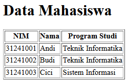
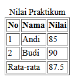
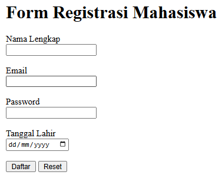
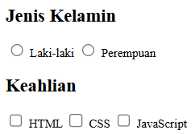
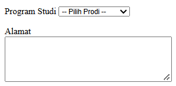
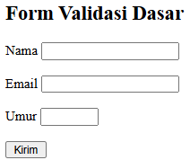
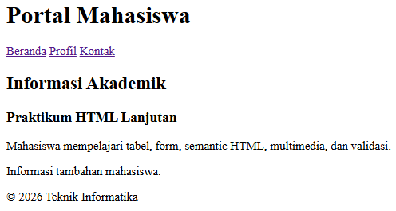
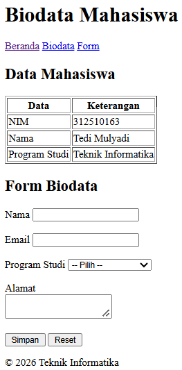

|  |  |
| -------- | --- |
| **Nama** | Tedi Mulyadi |
| **NIM** | 312510163 |
| **Kelas** | I251B |
| **Mata Kuliah** | Pemrograman web |
| **Dosen** | Agung Nugroho, S.Kom., M.Kom. |  

---

### 1. Pembuatan Tabel Data Mahasiswa (`index.html`)

Membangun tabel standar untuk menampilkan data baris dan kolom menggunakan tag `<table>`, `<tr>`, `<th>`, dan `<td>`.

```html
<table border="1">
    <tr>
        <th>NIM</th>
        <th>Nama</th>
        <th>Program Studi</th>
    </tr>
    <tr>
        <td>31241001</td>
        <td>Andi</td>
        <td>Teknik Informatika</td>
    </tr>
</table>
```

### Output



---

### 2. Pengelompokan Elemen Tabel (`index.html`)

Mengoptimalkan struktur tabel menggunakan tag `<thead>`, `<tbody>`, `<tfoot>`, serta atribut `colspan` untuk menggabungkan sel.

```html
<table border="1">
    <caption>Nilai Praktikum</caption>
    <thead>
        <tr>
            <th>No</th>
            <th>Nama</th>
            <th>Nilai</th>
        </tr>
    </thead>
    <tbody>
        <tr>
            <td>1</td>
            <td>Andi</td>
            <td>85</td>
        </tr>
    </tbody>
    <tfoot>
        <tr>
            <td colspan="2">Rata-rata</td>
            <td>87.5</td>
        </tr>
    </tfoot>
</table>
```

### Output



---

### 3. Formulir Pendaftaran Mahasiswa (`index.html`)

Membuat form input data seperti nama, email, password, dan tanggal lahir menggunakan tag `<form>` dan atribut `type`.

```html
<form>
    <label for="nama_reg">Nama Lengkap</label><br>
    <input type="text" id="nama_reg" name="nama"><br><br>

    <label for="email_reg">Email</label><br>
    <input type="email" id="email_reg" name="email"><br><br>

    <button type="submit">Daftar</button>
</form>
```

### Output



---

### 4. Pilihan Radio Button & Checkbox (`index.html`)

Mengimplementasikan pilihan tunggal menggunakan `type="radio"` dan pilihan ganda menggunakan `type="checkbox"`.

```html
<!-- Radio Button -->
<input type="radio" id="laki" name="jk" value="L">
<label for="laki">Laki-laki</label>

<!-- Checkbox -->
<input type="checkbox" id="html" name="skill" value="HTML">
<label for="html">HTML</label>
```

### Output



---

### 5. Menu Pilihan Select & Textarea (`index.html`)

Menyediakan dropdown pilihan program studi menggunakan `<select>` dan area untuk mengisi teks panjang menggunakan `<textarea>`.

```html
<select id="prodi_opt" name="prodi">
    <option value="ti">Teknik Informatika</option>
</select>

<textarea id="alamat_opt" name="alamat" rows="5" cols="40"></textarea>
```

### Output



---

### 6. Penerapan Validasi Input (`index.html`)

Memanfaatkan atribut bawaan HTML seperti `required`, `minlength`, `min`, dan `max` untuk memastikan data diisi sesuai format sebelum dikirim.

```html
<form>
    <input type="text" id="nama_val" name="nama" required minlength="3">

    <input type="number" id="umur_val" name="umur" min="17" max="60" required>

    <button type="submit">Kirim</button>
</form>
```

### Output



---

### 7. Penerapan Struktur Semantik (`index.html`)

Menyusun halaman web menggunakan elemen yang memiliki makna jelas seperti `<header>`, `<nav>`, `<main>`, `<section>`, `<article>`, `<aside>`, dan `<footer>`.

```html
<header>
    <h1>Portal Mahasiswa</h1>
</header>

<nav>
    <a href="#">Beranda</a>
</nav>

<main>
    <section>
        <article>
            <h3>Praktikum HTML Lanjutan</h3>
            <p>Penjelasan materi praktikum.</p>
        </article>
    </section>
</main>

<footer>
    <p>&copy; 2026 Teknik Informatika</p>
</footer>
```

### Output



---

### 8. Integrasi Berkas Multimedia (`index.html`)

Menampilkan elemen audio dan video menggunakan tag `<audio>` dan `<video>` dari direktori lokal `media/`.

```html
<audio controls>
    <source src="media/audio.mp3" type="audio/mpeg">
</audio>

<video controls width="480">
    <source src="media/video.mp4" type="video/mp4">
</video>
```

### Output


---

### 9. Proyek Mini: Halaman Biodata Terpadu (`biodata.html`)

Menggabungkan seluruh materi utama, yaitu struktur semantik, tabel data diri, formulir registrasi dengan validasi, serta media perkenalan ke dalam satu halaman biodata.

```html
<!DOCTYPE html>
<html lang="id">
<head>
    <meta charset="UTF-8">
    <title>Biodata Mahasiswa</title>
</head>

<body>

    <header>
        <h1>Biodata Mahasiswa</h1>
    </header>

    <nav>
        <a href="index.html">Beranda</a> |
        <a href="#biodata">Data Mahasiswa</a> |
        <a href="#form">Form Registrasi</a>
    </nav>

    <main>
        <section id="biodata">
            <h2>Data Mahasiswa</h2>

            <table border="1">
                <tr>
                    <td>NIM</td>
                    <td>312510163</td>
                </tr>
                <tr>
                    <td>Nama</td>
                    <td>Tedi Mulyadi</td>
                </tr>
            </table>
        </section>

        <section id="form">
            <h2>Form Biodata Mahasiswa</h2>

            <form action="" method="post">
                <input type="text" id="nama_bio" name="nama" required>
                <button type="submit">Simpan</button>
            </form>
        </section>
    </main>

    <footer>
        <p>&copy; 2026 Teknik Informatika</p>
    </footer>

</body>
</html>
```

### Output



---